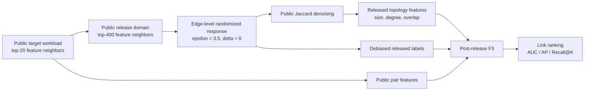

# Post-release Learned Fusion for Edge-Private Link Prediction

Research log for edge-level differentially private link prediction on
graphs with public node features.

> Status: exploratory research, not peer reviewed. Results below are
> frozen experiments with recorded protocols and controls, but the
> work is still being prepared for a formal proposal and paper.

## Research question

Can one edge-DP release of a public-candidate graph support useful link
prediction when all later computation is restricted to:

- the released graph;
- public node identifiers and node features;
- public target-workload construction?

The current answer is **yes in the tested regimes**, provided that the
released graph is used by a learned post-release model rather than a
fixed topology/public rank blend.

## Method



The post-release model does not read the original private graph or
private test labels. Training on the released graph and public
features is therefore post-processing of the edge-DP output.

## Headline results

Median AUC over independent edge-DP releases:

| Dataset | Split | Public only | Joint F3 | Topology placebo | Joint - placebo |
| --- | ---: | ---: | ---: | ---: | ---: |
| Cora | 0 | 0.7237 | 0.8326 | 0.7136 | +0.1182 |
| Cora | 1 | 0.7023 | 0.8344 | 0.6923 | +0.1389 |
| Cora | 2 | 0.7231 | 0.8364 | 0.7192 | +0.1187 |
| Citeseer | 0 | 0.8152 | 0.8696 | 0.8107 | +0.0595 |
| Citeseer | 1 | 0.7867 | 0.8440 | 0.7836 | +0.0550 |
| Citeseer | 2 | 0.8114 | 0.8649 | 0.8127 | +0.0530 |
| BlogCatalog | 0 | 0.5285 | 0.8652 | 0.5310 | +0.3348 |

The joint model beats the public-only and placebo models in all
`70 / 70` measured releases across these seven dataset/split settings.

The public features alone are weak on BlogCatalog (`AUC 0.5285`) but
strong on Citeseer (`AUC 0.7867-0.8152`). The released topology adds
signal in both regimes.

## Why a learned post-release model?

A fixed `0.75 * topology_rank + 0.25 * public_rank` fusion passed on
Cora but failed on Citeseer, where public features were much stronger.
Replacing the fixed blend with an F3 trained on released labels and
public features removed that boundary.

## Mechanism ablation

The released topology block contains:

```text
size      = [0]
degree    = [1,2,3,4]
overlap   = [5,6,7]
context   = [8]
```

Findings:

- F3 outperforms a linear readout by `+0.16` to `+0.34` median AUC.
- Removing the overlap group loses `-0.02` to `-0.12` median AUC and
  much more Average Precision.
- Removing the context indicator `[8]` does not hurt and can slightly
  improve results.

The next frozen configuration will use the 8-dimensional topology
block `[0,1,2,3,4,5,6,7]`.

## Privacy scope

This project currently claims **edge-level DP only**:

- one undirected edge add/remove is the privacy unit;
- upper-triangle randomized response uses `epsilon=3.5`, `delta=0`;
- all downstream model training reads only the released graph and
  public side information;
- node-level DP and attribute-level DP are outside the claim.

## Repository contents

- [`src/postrelease_lp.py`](src/postrelease_lp.py): minimal end-to-end
  reproduction implementation.
- [`docs/reproduce.md`](docs/reproduce.md): install and run commands.
- [`docs/method.md`](docs/method.md): release interface and model.
- [`docs/results.md`](docs/results.md): full result tables.
- [`docs/privacy.md`](docs/privacy.md): threat model and accounting.
- [`docs/mechanism.md`](docs/mechanism.md): ablations and interpretation.
- [`docs/open-questions.md`](docs/open-questions.md): unresolved work.
- [`results/`](results/): compact, sanitized CSV results.

## Quick start

```bash
pip install -r requirements.txt
python -m unittest discover -s tests -v
python -m src.postrelease_lp \
  --dataset cora \
  --data /path/to/cora.mat \
  --split-salt 2 \
  --release-draws 10 \
  --topology-dimension 8 \
  --output outputs/cora_split2.json
```

The implementation defaults to the simplified 8-dimensional topology
block identified by the mechanism ablation.

## Data

Experiments use public link-prediction datasets distributed with SEAL:
Cora, Citeseer, and BlogCatalog. Raw datasets and machine-specific
artifacts are not redistributed in this repository.

## Next steps

1. Reconfirm the 8-feature topology block across all seven settings.
2. Compare against DPLP and PriDyG under a common measurement protocol.
3. Audit the post-release data path so production code cannot read the
   raw graph.
4. Complete the research proposal after the baseline and privacy
   closure are stable.
